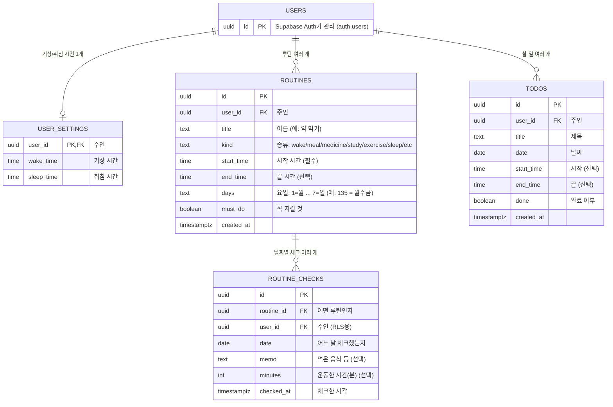

# DB 구조 설계

PRD의 "1:1 자기관리 코치" 기능을 담기 위한 표 설계입니다.
길 A 구현: [src/db/sqlite-init.ts](src/db/sqlite-init.ts) (표 생성 SQL), [src/db/schema.ts](src/db/schema.ts) (Drizzle 정의)

## 구조도



## 핵심 설계 결정

### 1. 루틴(ROUTINES)과 체크(ROUTINE_CHECKS)를 나눈 이유
- **루틴은 "규칙"** 이다: "매일 07:50 약 먹기"는 한 번만 저장한다.
- **체크는 "날짜별 기록"** 이다: 10/29에 했는지, 10/30에 했는지는 날마다 따로 저장한다.
- 그래서 루틴 1개 : 체크 여러 개 (**일대다**) 관계가 된다.
- 한 표에 넣으면 날마다 루틴을 복사해야 하고, 루틴 시간을 고칠 때 모든 복사본을 고쳐야 한다.
- 체크 기록이 쌓이므로 코치가 **연속 성공, 이번 주 운동 총 시간**을 계산할 수 있다.

### 2. 할 일(TODOS)을 루틴과 따로 둔 이유
- 할 일은 **그날 한 번만** 있는 일이라 "규칙"이 필요 없다. 그래서 완료 여부(`done`)를 행에 바로 둔다.
- 화면에서는 루틴과 할 일을 **시간순으로 섞어서** 하나의 시간표로 보여 준다.

### 3. 체크에도 user_id를 둔 이유
- RLS 규칙을 `user_id = 로그인한 사람` 한 줄로 모든 표에 똑같이 적용할 수 있다.
- (user_id가 없으면 "이 체크의 루틴의 주인"을 매번 따라가서 확인해야 해서 규칙이 복잡해진다.)

### 4. 체크를 지우면 "체크 취소"
- 체크 취소 = ROUTINE_CHECKS 행 삭제. 상태 칸을 따로 두지 않아 단순하다.
- 루틴을 지우면 그 루틴의 체크 기록도 함께 지운다 (`on delete cascade`).

## DB가 직접 지키는 규칙 (제약 조건)
| 규칙 | 이유 |
|---|---|
| `routine_checks`의 `(routine_id, date)`는 하나만 | 같은 날 같은 루틴을 두 번 체크하지 못하게 |
| `kind`는 정해진 7가지만 | 오타로 이상한 종류가 들어가지 않게 |
| `end_time`이 있으면 `start_time`보다 늦어야 함 | 끝이 시작보다 빠른 일정 방지 |
| `minutes`는 0 이상 | 음수 운동 시간 방지 |
| `days`는 1~7 숫자만 | 없는 요일 방지 |

## 코치가 데이터를 쓰는 방법
| 코칭 | 계산 방법 |
|---|---|
| "약 먹을 시간이 10분 지났어요" | 오늘 요일의 루틴 중 `start_time`이 지났는데 오늘 체크가 없는 것 (꼭 지킬 것은 5분, 나머지는 15분 지나면) |
| "오늘 6/8 완료" | 오늘 체크 수 / 오늘 요일의 루틴 수 (+ 할 일) |
| "공부 5일 연속 🔥" | 그 루틴의 체크 날짜가 오늘(또는 어제)부터 끊기지 않고 이어진 날 수 |
| "이번 주 운동 총 120분" | 이번 주 운동 루틴 체크의 `minutes` 합계 |
| "점심을 거르셨네요" | 식사 루틴 시간이 한참 지났는데 체크가 없음 |

## 길 A / 길 B 차이
| | 길 A (SQLite) | 길 B (Supabase) |
|---|---|---|
| USERS | 없음. `user_id`에 고정값 `local-user` | `auth.users` (Supabase Auth) |
| 날짜/시간 | 글자로 저장 (`2026-10-29`, `07:50`) | `date`, `time` 타입 |
| 참/거짓 | 0/1 숫자 | `boolean` |
| 보안 | 내 컴퓨터 전용 | 모든 표에 RLS: `user_id = auth.uid()` |

## 대표 SQL
```sql
-- 10/29(목요일)의 내 루틴 + 체크 여부, 시간순
SELECT r.title, r.start_time, c.id IS NOT NULL AS checked, c.memo
FROM routines r
LEFT JOIN routine_checks c
  ON c.routine_id = r.id AND c.date = '2026-10-29'
WHERE r.user_id = '내 id'
  AND r.days LIKE '%4%'          -- 4 = 목요일
ORDER BY r.start_time;
```
- `LEFT JOIN`: 체크가 **없는** 루틴도 빠지지 않고 나오게 한다. 그래야 "아직 안 한 루틴"을 찾을 수 있다.
