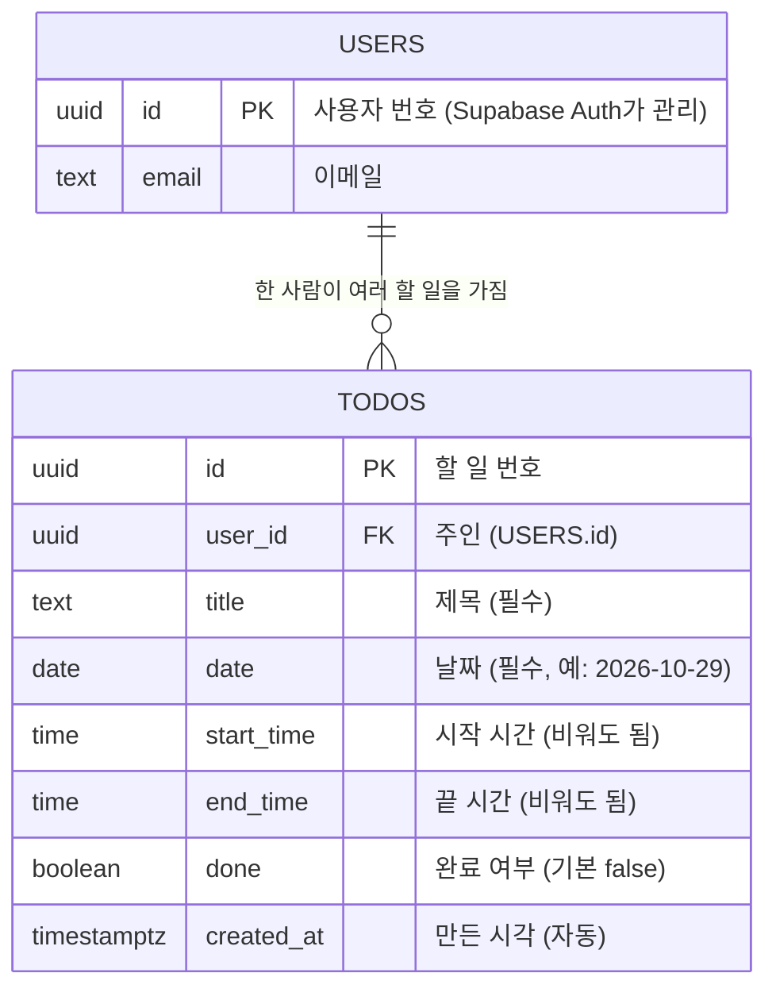

# DB 구조 설계

## 구조도



- **USERS**: 직접 만들지 않는다. 로그인 도구(Supabase Auth)가 `auth.users` 표로 관리한다.
- **TODOS**: 우리가 만드는 표. `user_id`로 주인을 기록한다.
- **관계**: 사용자 1명 : 할 일 여러 개 (일대다)

## 칸(열) 설명

| 칸 | 종류 | 비워도 됨? | 의미 / 이렇게 정한 이유 |
|---|---|---|---|
| `id` | uuid | X | 할 일 하나하나의 고유 번호. 완료/삭제할 때 "어느 할 일인지" 가리킨다. 1,2,3 대신 무작위 값이라 남이 다음 번호를 추측할 수 없다 |
| `user_id` | uuid | X | 이 할 일의 주인. **"내 것만 보기"와 RLS의 기준**이 되는 칸 |
| `title` | text | X | 할 일 제목 |
| `date` | date | X | 어느 날의 할 일인지. **이번 주 날짜 버튼**을 누르면 이 칸으로 찾는다. 시간이 없는 할 일도 날짜는 있어야 하므로 시간과 따로 둔다 |
| `start_time` | time | O | 시작 시간. 비어 있으면 "시간 없는 할 일" 목록으로 간다 |
| `end_time` | time | O | 끝 시간. "남은 시간(분)"과 진행 막대를 계산할 때 쓴다 |
| `done` | boolean | X | 완료 여부. 기본값은 false(미완료) |
| `created_at` | timestamptz | X | 만든 시각. 자동으로 기록하며, 시간이 같을 때 정렬 기준으로 쓴다 |

## 규칙 (DB가 직접 지키게 함)
- `end_time`이 있으면 `start_time`도 있어야 하고, `end_time > start_time` 이어야 한다.
- `(user_id, date)`에 색인(index)을 둔다: "내 할 일 중 이 날짜"를 빠르게 찾기 위해서다.

## 길 A / 길 B 차이
| | 길 A (SQLite) | 길 B (Supabase) |
|---|---|---|
| `user_id` | 로그인이 없어서 고정값 `local-user`를 넣는다 | 로그인한 사용자의 실제 id를 넣는다 |
| 날짜/시간 | 글자로 저장 (`2026-10-29`, `09:30`) | `date`, `time` 타입으로 저장 |
| 보안 | 내 컴퓨터 전용 | RLS: `user_id = auth.uid()` 인 행만 허용 |

## 대표 SQL
```sql
-- 선택한 날짜의 내 할 일을 시간순으로 (시간 없는 것은 뒤로)
SELECT * FROM todos
WHERE user_id = '내 id' AND date = '2026-10-29'
ORDER BY start_time NULLS LAST, created_at;
```
